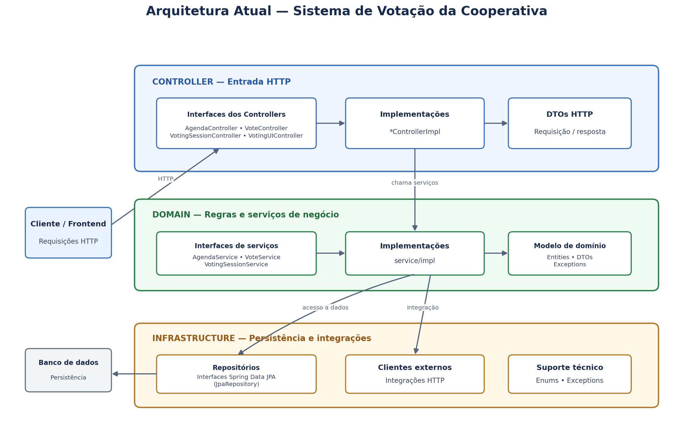

# Sistema de Votação da Cooperativa — System Design

## 1. Visão Geral do Projeto

O Sistema de Votação da Cooperativa é uma aplicação backend desenvolvida para gerenciar processos de votação de cooperativas.
O sistema disponibiliza funcionalidades para gerenciamento de pautas, controle de sessões de votação, validação de associados e registro de votos.
A aplicação foi desenvolvida utilizando Java e Spring Boot, seguindo uma arquitetura em camadas, organizada em torno dos pacotes Controller, Domain e Infrastructure.

##Objetivos principais

Gerenciar pautas de votação.
Criar e gerenciar sessões de votação.
Validar associados da cooperativa.
Registrar votos.
Impedir votos duplicados.
Permitir a consulta dos resultados das votações.
Garantir a consistência dos dados e a aplicação das regras de negócio.

## 2. Tecnologias Utilizadas

Tecnologia
Responsabilidade
Java
Linguagem de programação
Spring Boot
Framework da aplicação
Spring MVC
API REST
Spring Data JPA
Abstração de acesso a dados
Hibernate / JPA
Mapeamento objeto-relacional e persistência
OpenFeign
Comunicação com serviços externos
Resilience4j
Mecanismos de tolerância a falhas
Maven
Gerenciamento de dependências

## 3. Arquitetura Atual

A aplicação utiliza uma arquitetura em camadas, com separação de responsabilidades.

## 3.1. Camada Controller

Responsável por disponibilizar os endpoints REST e tratar a comunicação HTTP.

Componentes:

Interfaces dos controllers.
Implementações dos controllers.
DTOs de requisição e resposta HTTP.

As interfaces definem os contratos da API, enquanto suas implementações recebem as requisições e delegam as operações aos serviços do domínio.

## 3.2. Camada Domain (Domínio)

Contém os conceitos de negócio e as operações relacionadas às regras do sistema.

Componentes:

Entidades.
DTOs de domínio.
Exceções de negócio.
Interfaces dos serviços.
Implementações dos serviços.

As interfaces dos serviços definem as operações disponíveis, enquanto suas implementações coordenam as regras de negócio e acessam as dependências necessárias.

## 3.3. Camada Infrastructure (Infraestrutura)

Responsável pelas integrações técnicas e pelos mecanismos de persistência.

Componentes:

Repositórios Spring Data JPA.
Clientes de serviços externos.
Exceções de infraestrutura.
Enumerações técnicas.

O Spring Data JPA fornece abstrações de repositório para acesso ao banco de dados.

Os clientes externos são responsáveis pela comunicação com outros serviços.

4. Estrutura Atual de Pacotes

com.cooperativa.voto.api
│
├── controller
│   ├── api
│   │   ├── AgendaController
│   │   ├── VoteController
│   │   ├── VotingSessionController
│   │   └── VotingUIController
│   │
│   ├── dto
│   │
│   ├── AgendaControllerImpl
│   ├── VoteControllerImpl
│   ├── VotingSessionControllerImpl
│   └── VotingUIControllerImpl
│
├── domain
│   ├── dto
│   ├── entity
│   ├── exception
│   └── service
│       ├── interfaces dos serviços
│       └── implementações dos serviços
│
├── infrastructure
│   ├── client
│   ├── enums
│   ├── exception
│   └── repository
│       └── repositórios Spring Data JPA
│
└── Application
