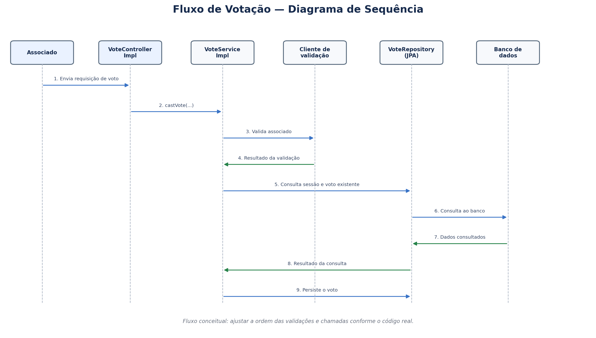

# Sistema de Votação da Cooperativa — System Design

## 1. Visão Geral do Projeto

O Sistema de Votação da Cooperativa é uma aplicação backend desenvolvida para gerenciar processos de votação de cooperativas.
O sistema disponibiliza funcionalidades para gerenciamento de pautas, controle de sessões de votação, validação de associados e registro de votos.
A aplicação foi desenvolvida utilizando Java e Spring Boot, seguindo uma arquitetura em camadas, organizada em torno dos pacotes Controller, Domain e Infrastructure.

##Objetivos principais

Gerenciar pautas de votação.
Criar e gerenciar sessões de votação.
Validar associados da cooperativa.
Registrar votos.
Impedir votos duplicados.
Permitir a consulta dos resultados das votações.
Garantir a consistência dos dados e a aplicação das regras de negócio.

## 2. Tecnologias Utilizadas

Tecnologia
Responsabilidade
Java
Linguagem de programação
Spring Boot
Framework da aplicação
Spring MVC
API REST
Spring Data JPA
Abstração de acesso a dados
Hibernate / JPA
Mapeamento objeto-relacional e persistência
OpenFeign
Comunicação com serviços externos
Resilience4j
Mecanismos de tolerância a falhas
Maven
Gerenciamento de dependências

## 3. Requisitos funcionais
Considerando o funcionamento que já identificamos:
ID	Requisito
RF01	Cadastrar e consultar pautas.
RF02	Criar sessões de votação.
RF03	Abrir e encerrar sessões.
RF04	Validar o CPF do associado.
RF05	Permitir votação nas sessões abertas.
RF06	Registrar o voto do associado.
RF07	Impedir votos duplicados na mesma pauta.
RF08	Consultar resultados da votação.

Uma regra de negócio especialmente importante que você já implementou é:

Um associado pode registrar somente um voto por pauta.

No seu método castVote(Long agendaId, String cpf, OptionVoteEnum option), você já trabalha com as seguintes verificações:
1. Localizar a pauta/sessão.
2. Verificar se a sessão está aberta.
3. Identificar o associado pelo CPF.
4. Verificar se já existe voto para aquela combinação de pauta e associado.
5. Registrar o voto.
2. Requisitos não funcionais
Aqui estão os requisitos que eu colocaria como objetivos arquiteturais. Alguns ainda precisam ser confirmados como requisitos formais do seu projeto.
- Consistência: não permitir votos duplicados.
- Disponibilidade: manter o sistema operacional durante as sessões.
- Desempenho: suportar acessos concorrentes durante períodos de votação.
- Segurança: proteger os dados dos associados e a integridade dos votos.
- Resiliência: suportar indisponibilidade temporária de serviços externos.
- Auditabilidade: permitir rastrear operações administrativas e eventos relevantes.

## 4. Arquitetura Atual

A aplicação utiliza uma arquitetura em camadas, com separação de responsabilidades.


## 4.1. Camada Controller

Responsável por disponibilizar os endpoints REST e tratar a comunicação HTTP.

Componentes:

Interfaces dos controllers.
Implementações dos controllers.
DTOs de requisição e resposta HTTP.

As interfaces definem os contratos da API, enquanto suas implementações recebem as requisições e delegam as operações aos serviços do domínio.

## 4.2. Camada Domain (Domínio)

Contém os conceitos de negócio e as operações relacionadas às regras do sistema.

Componentes:

Entidades.
DTOs de domínio.
Exceções de negócio.
Interfaces dos serviços.
Implementações dos serviços.

As interfaces dos serviços definem as operações disponíveis, enquanto suas implementações coordenam as regras de negócio e acessam as dependências necessárias.

## 4.3. Camada Infrastructure (Infraestrutura)

Responsável pelas integrações técnicas e pelos mecanismos de persistência.

Componentes:

Repositórios Spring Data JPA.
Clientes de serviços externos.
Exceções de infraestrutura.
Enumerações técnicas.

O Spring Data JPA fornece abstrações de repositório para acesso ao banco de dados.

Os clientes externos são responsáveis pela comunicação com outros serviços.

## 5. Estrutura Atual de Pacotes

```text
com.cooperativa.voto.api
│
├── controller
│   ├── api
│   │   ├── AgendaController
│   │   ├── VoteController
│   │   ├── VotingSessionController
│   │   └── VotingUIController
│   │
│   ├── dto
│   │
│   ├── AgendaControllerImpl
│   ├── VoteControllerImpl
│   ├── VotingSessionControllerImpl
│   └── VotingUIControllerImpl
│
├── domain
│   ├── dto
│   ├── entity
│   ├── exception
│   └── service
│       ├── Interfaces dos serviços
│       └── Implementações dos serviços
│
├── infrastructure
│   ├── client
│   ├── enums
│   ├── exception
│   └── repository
│       └── Repositórios Spring Data JPA
│
└── Application
```
## 6. Fluxo de votação



O diagrama de sequência acima apresenta o fluxo de execução de uma operação de votação, detalhando a comunicação entre os principais componentes do sistema: associado, controller, serviço de domínio, cliente de integração externa, repositório e banco de dados.

O fluxo começa quando o associado solicita o registro de seu voto por meio da API. O controller recebe a requisição, realiza o tratamento dos dados de entrada e encaminha a operação ao serviço responsável pelas regras de negócio.

O serviço coordena o processo de votação, realizando as validações necessárias, incluindo a verificação da situação do associado por meio de uma integração externa, a confirmação da existência e validade da sessão de votação e a verificação de possíveis registros anteriores para evitar votos duplicados.

Após a conclusão das validações, o serviço solicita ao repositório a persistência do voto. O repositório, utilizando Spring Data JPA, realiza a comunicação com o banco de dados e retorna o resultado da operação.

Por fim, o serviço devolve o resultado ao controller, que constrói e retorna a resposta HTTP ao associado.

Dessa forma, o diagrama evidencia a sequência de interações, a distribuição de responsabilidades entre os componentes e o papel de cada camada na execução do processo de votação, contribuindo para a compreensão do fluxo de negócio e dos mecanismos de integração e persistência da aplicação.
